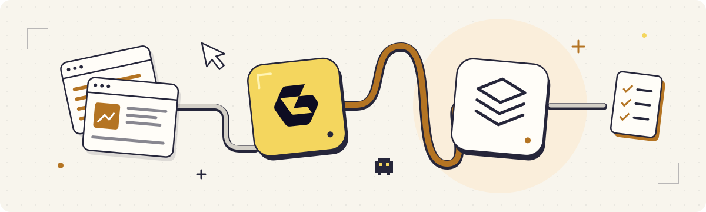

# Geonode Skills: Web Scraping for AI Agents

Three skills that teach your agent how to get useful web data with Geonode.

| Skill | What it does | Try asking |
| --- | --- | --- |
| [scrape-page](skills/scrape-page/SKILL.md) | Saves a web page as clean Markdown. | “Save this article as Markdown with its source URL.” |
| [extract-dataset](skills/extract-dataset/SKILL.md) | Turns pages into a CSV or JSON dataset. | “Extract names, prices and currencies from these product URLs.” |
| [research-web](skills/research-web/SKILL.md) | Answers a question using web sources. | “Compare these products’ pricing and shipping, with citations.” |

## Install

Clone this repository:

```sh
git clone https://github.com/geonodecom/skills.git geonode-skills
cd geonode-skills
```

Copy the skills into your agent’s skills directory. These commands leave existing files in place; move an older copy aside before installing an update.

**Codex**

```sh
mkdir -p "$HOME/.agents/skills"
cp -Rn skills/* "$HOME/.agents/skills/"
```

**Claude Code**

```sh
mkdir -p "$HOME/.claude/skills"
cp -Rn skills/* "$HOME/.claude/skills/"
```

Open a new session. Invoke `$scrape-page`, `$extract-dataset` or `$research-web` in Codex; use `/scrape-page`, `/extract-dataset` or `/research-web` in Claude Code. Include the URL or question in your request.

If you installed the earlier `geonode-web-data` skill, remove that old installed folder once you switch to these three.

## Connect Geonode

Use an existing [Geonode MCP connection](https://docs.geonode.com/docs/scraper-api/guides/mcp/00_overview), or the [Geonode CLI](https://github.com/geonodecom/cli). The skills use those tools; there is no additional runtime to install.

MCP supports [limited page extraction without an API key](https://docs.geonode.com/docs/scraper-api/guides/mcp/01_use-without-an-api-key). Account-backed requests need a Geonode API key. Your agent does the field extraction and research reasoning using the returned content.

[API documentation](https://docs.geonode.com/docs/scraper-api) · [Support](https://geonode.com/contact) · [MIT license](LICENSE)
